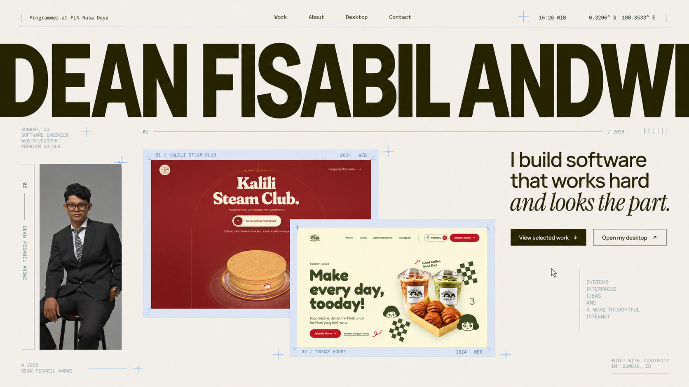
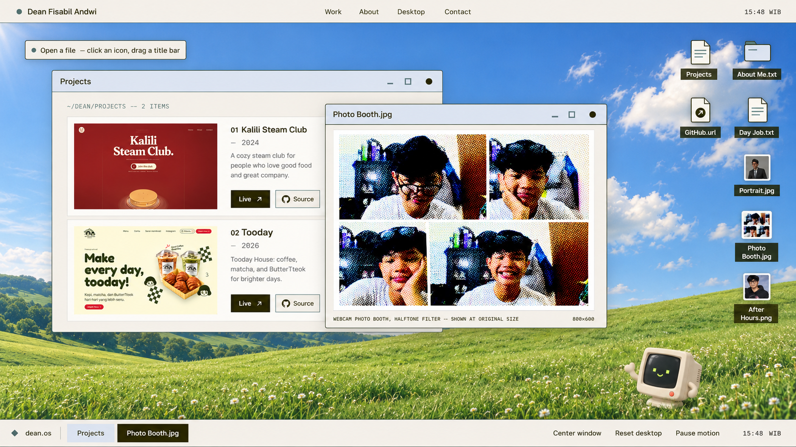
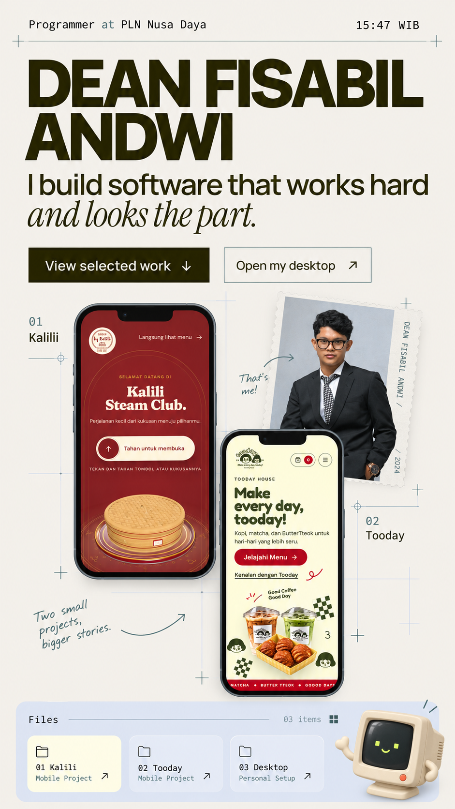

# Quiet Machine / Personal Workstation

Desain visual final untuk portofolio Dean Fisabil Andwi  
Tanggal: 20 Oktober 2026  
Status: desain saja — tanpa implementasi kode

## Ringkasan arah

Portofolio ini mempertemukan dua sisi Dean dalam satu bahasa visual:

- **Quiet Machine** — presisi, tanggung jawab, sistem internal, dan keamanan web pada pekerjaan sehari-hari.
- **Personal Workstation** — proyek independen, eksperimen visual, foto personal, serta karakter yang muncul setelah jam kerja.

Hasil akhirnya harus terasa seperti editorial digital yang menemukan sebuah komputer pribadi di tengah halaman: tenang dari jauh, penuh detail saat didekati, dan terasa benar-benar milik Dean.

Desain bukan replika Windows dan bukan tiruan literal Neutomni. Referensi dipakai untuk keberanian skala, ritme ruang kosong, perubahan ukuran saat scroll, dan rasa bermain. Identitas visualnya tetap milik Dean.

## Artboard utama

### Homepage desktop

Artboard ini menetapkan skala wordmark, hierarki hero, bingkai teknis, potret vertikal, serta hubungan visual antara Kalili dan Tooday.

### Personal desktop

Artboard ini menetapkan bentuk jendela, susunan ikon, kepadatan desktop, taskbar, dan porsi wallpaper yang harus tetap bernapas.

### Homepage mobile

Artboard mobile menunjukkan adaptasi komposisi, bukan pengecilan tampilan desktop. Teks pada artboard bersifat visual; nama, tahun, dan copy final mengikuti data aktual pada brief.

## Gagasan yang diingat pengunjung

Elemen khasnya adalah **registration marks**: garis tipis, koordinat, nomor gambar, crosshair, dan diamond kecil yang terasa seperti tanda ukur dari seorang programmer, tetapi dipakai dengan disiplin editorial. Detail ini muncul jarang dan hanya di sekitar media penting.

Tiga motif menyatukan halaman:

1. **Cut line** — garis horizontal yang “membelah” pembuka dan membuka hero.
2. **Registration frame** — bingkai mist tipis di sekitar proyek, potret, dan layar monitor.
3. **Diamond cursor** — bentuk kecil yang menjadi penunjuk progres, status aktif, dan aksen CTA.

Tidak ada ornamen acak. Setiap motif selalu berarti membuka, mengukur, memilih, atau berpindah.

## Bahasa visual

### Warna

| Peran | Warna | Pemakaian |
|---|---|---|
| Bidang utama | Ivory `#F2EFEA` | Latar halaman, jendela, ruang negatif |
| Identitas | Olive `#272401` | Wordmark, heading, CTA utama, process cards, footer |
| Detail teknis | Mist `#DFE5F3` | Frame proyek, title bar, panel sekunder, garis registrasi |
| Aksen interaksi | Teal `#557373` | Fokus, garis aktif, ikon, status, hover |
| Teks | Ink `#0D0D0D` | Paragraf, label penting, metadata kontras |

Ivory mendominasi sekitar 60–65% halaman. Olive menjadi massa besar yang muncul pada momen penting. Mist dan teal dipakai sebagai instrumen, bukan dekorasi yang memenuhi halaman. Warna asli foto dan screenshot proyek tidak diubah.

### Tipografi

- **Wordmark:** Manrope ExtraBold/Black, sangat rapat, terasa seperti poster dan sesekali terpotong tepi viewport.
- **Headline:** Manrope Medium/Semibold dengan leading ketat.
- **Aksen manusia:** Instrument Serif Italic hanya satu frasa dalam satu bidang pandang.
- **Metadata:** monospace sistem untuk waktu, koordinat, nomor gambar, path, dan ukuran file.
- **Body:** Manrope Regular, panjang baris maksimal sekitar 62 karakter.

Kontras sans dan serif harus terasa seperti “sistem” dan “karakter”, bukan sekadar variasi font.

### Bentuk dan material

- Mayoritas sudut tegas; radius kecil hanya pada frame foto, monitor, dan jendela.
- Garis 1px olive/teal lebih penting daripada shadow.
- Shadow hanya untuk menunjukkan urutan jendela dan kedalaman CRT.
- Tekstur kertas sangat halus boleh hadir pada halaman ivory.
- Tidak memakai gradient dekoratif, glassmorphism, neon, chrome metalik, atau kartu bundar bergaya dashboard.

## Struktur halaman

### 00 — Opening: Cut The Line

Layar pertama berupa bidang olive dengan nama Dean dalam ivory di bagian bawah. Sebuah diamond kecil bergerak dari kiri ke kanan, menggambar garis potong. Saat garis selesai, bidang terbelah dan hero ivory terlihat di baliknya.

Pembuka terasa seperti tindakan membuka berkas, bukan iklan loading. Nomor progres hanya boleh mengikuti aset nyata. Tombol **Skip intro** selalu terlihat dan tidak mengganggu komposisi.

### 01 — Hero: Name As Interface

Nama **DEAN FISABIL ANDWI** menjadi objek terbesar di halaman. Pada desktop, wordmark menyeberangi hampir seluruh viewport dan sedikit terpotong di sisi kiri/kanan agar terasa lebih besar daripada layar.

Susunan hero:

- Baris paling atas: peran di kiri, navigasi di tengah, email dan waktu WIB di kanan.
- Wordmark raksasa pada bagian atas/tengah.
- Sisi kanan bawah: headline “I build software that works hard / *and looks the part.*”.
- Sisi kiri bawah: metadata Dean, PLN Nusa Daya, dan Universitas Andalas dalam bentuk docket ringkas.
- Bagian dasar: contact sheet Kalili–Tooday yang mulai memasuki viewport berikutnya.

CTA tidak boleh mengalahkan nama. Tombol utama olive berukuran ringkas; CTA desktop hanya outline tipis.

### 02 — Project Montage: Two Small Projects, Bigger Stories

Kalili dan Tooday tampil seperti dua lembar transparansi kerja yang sedang dibandingkan di meja cahaya.

- Kalili menjadi bidang belakang yang lebih besar dan berat.
- Tooday menumpang di kanan bawah untuk menciptakan arah diagonal.
- Frame mist, nomor proyek, tahun 2026, kategori, dan registration marks menjaga keduanya tetap menjadi bagian dari sistem portofolio.
- Potret vertikal Dean hadir sebagai strip sempit, bukan foto hero kedua.

Saat scroll, seluruh contact sheet membesar sebagai satu objek. Teks caption tetap stabil dan tidak bergerak melawan media.

### 03 — About: Operator / Maker

Bagian About memakai struktur dua sisi yang tidak simetris:

- Kiri: judul besar “Operator by day, / *maker after hours.*”.
- Tengah: potret studio dengan crop vertikal yang mempertahankan ruang kosong asli di atas kepala.
- Kanan: dua paragraf bio, diikuti dua kartu tipis **Currently** dan **Graduated**.

Di bawah bio, sebuah rail kecil membagi pekerjaan Dean menjadi dua jalur:

- **Keeps systems running** — ERP, E-Arsip, Kinerja, GCG.
- **Keeps the web surface clean** — SecurityScorecard, TLS, headers, remediation.

Rail ini hanya memberi orientasi. Detail lengkap tetap berada pada `Day Job.txt` di desktop personal.

### 04 — How I Work: Four System States

Empat langkah tampil sebagai empat slab olive yang tidak identik tingginya. Di awal, tepi atas kartu membentuk grafik yang tidak rata. Setelah pengunjung melewati section, semuanya menyatu pada baseline yang sama.

Isi:

1. **Understand / the people**
2. **Design / with intent**
3. **Build / it properly**
4. **Refine / the details**

Nomor besar diposisikan seperti penanda file, bukan badge. Instrument Serif hanya dipakai pada frasa kedua. Tidak ada ikon generik untuk setiap langkah.

### 05 — Selected Work: Work Before Decoration

Section ini memakai satu panggung besar, bukan grid kartu.

#### Kalili Steam Club

- Screenshot merah menjadi massa visual dominan.
- Metadata berada pada kolom sempit: `01`, Dimsum by Kalili, 2026, stack.
- Ringkasan dan empat highlight muncul sebagai catatan editorial di sisi lain.
- CTA **Live website** berbentuk olive; **View source** berupa text-link dengan garis teal.

#### Tooday

- Layout berbalik agar halaman memiliki ritme.
- Bidang cream proyek dibiarkan utuh sehingga karakter asli Tooday tetap terbaca.
- Preview mobile tampil sebagai inset kecil untuk membuktikan responsivitas tanpa membuat mockup perangkat berlebihan.

Peralihan proyek memakai wipe vertikal seperti mengganti lembar kerja. Detail proyek tidak disembunyikan hanya demi animasi.

### 06 — Enter My Desktop: From Object To Place

Monitor CRT pertama kali tampak sebagai benda utuh di bidang ivory. Bezel mist memiliki bayangan teal lembut, tombol olive, dan bukaan layar reguler. Wallpaper sudah terlihat dari jauh agar transisi terasa masuk akal.

Saat scroll:

1. Monitor hadir sebagai objek sekitar 60% lebar viewport.
2. Kamera mendekati aperture layar.
3. Bezel keluar menuju tepi viewport.
4. Layar menjadi desktop datar yang bisa digunakan.

Tombol **Open my desktop** membawa pengguna langsung ke keadaan akhir yang interaktif.

### 07 — Personal Workstation

Desktop harus terlihat sudah dipakai, tetapi tidak berantakan.

#### Tata letak awal

- Wallpaper langit dan bukit mengisi seluruh stage.
- Ikon berada di kanan dalam dua kolom yang konsisten.
- Window **Projects** terbuka di kiri bawah dengan ukuran medium.
- Foto personal tetap tertutup saat pertama masuk.
- Bubble “Open a file” berada di kiri atas dan hilang setelah interaksi pertama.
- Maskot CRT kecil berdiri dekat rumput kanan bawah, jauh dari ikon.

#### Window chrome

- Surface ivory, title bar mist, outline olive tipis.
- Close berupa olive dot; minimize dan maximize memakai garis/square teal.
- Kontrol memiliki area tekan besar tetapi simbol tetap kecil.
- Shadow pendek dan tegas menunjukkan z-order.
- Path atau ukuran file memakai monospace di status bar bawah.

#### Aplikasi

- **Projects:** daftar dua proyek dengan screenshot autentik, Live, dan Source.
- **About Me.txt:** bio singkat dalam layout dokumen.
- **Day Job.txt:** dua folder tanggung jawab dan daftar aplikasi internal.
- **Portrait.jpg:** foto studio dalam mode contain.
- **Photo Booth.jpg:** kolase utuh dengan caption `800×600`.
- **After Hours.png:** foto personal dalam viewer sederhana.
- **Contact.txt:** email, LinkedIn, GitHub.
- **GitHub.url:** shortcut eksternal, bukan window palsu.

Desktop tidak boleh membuka banyak jendela sekaligus untuk sekadar terlihat interaktif. Satu atau dua jendela sudah cukup untuk menunjukkan kedalaman.

### 08 — Contact: Close The Session

Bidang kembali menjadi ivory dan memberi jeda setelah desktop yang kaya visual. CTA “Let’s build something.” berada di tengah jalur putus-putus. Diamond dari intro kembali, bergerak ke tengah, lalu berubah menjadi shape olive yang lembut tetapi tetap geometris.

Footer menjadi blok olive penuh:

- Email dan sosial di bagian atas.
- Waktu WIB dan status di sudut.
- Wordmark **ANDWI** dalam ivory memenuhi bagian bawah dan sedikit terpotong.

Halaman berakhir dengan motif yang sama seperti saat dibuka sehingga pengalaman terasa selesai.

## Desain mobile

Mobile tidak meniru desktop bertumpuk.

- Header menjadi dua baris: metadata di atas, empat link utama di bawah.
- Wordmark menjadi dua baris besar: `DEAN FISABIL` dan `ANDWI`.
- Headline full width; CTA utama dan sekunder dapat bertumpuk pada layar sempit.
- Project montage menjadi dua preview tinggi yang saling offset, bukan sticky zoom.
- Potret menjadi ticket kecil di antara proyek, bukan kolom terpisah.
- Process cards tampil vertikal dengan nomor besar di tepi.
- Selected Work memakai satu proyek per layar tanpa pin.
- Monitor hanya menjadi preview dan tombol pembuka.
- Desktop berubah menjadi file browser 2–3 kolom dengan satu panel aktif.
- Panel aktif memiliki **Back to files**, **Next file**, dan **Close**; tidak ada drag, minimize, maximize, atau jendela tumpang tindih.

Target minimum sentuh 44×44px dan tidak ada horizontal scroll.

## Motion language

Gerakan utama hanya muncul pada momen yang mengubah konteks:

| Momen | Rasa gerak |
|---|---|
| Intro | Garis memotong, bidang membuka |
| Wordmark | Naik dari mask, berat tetapi cepat |
| Montage | Mendekat sebagai satu lembar kerja |
| Process | Empat level menjadi satu baseline |
| Selected work | Mengganti lembar, bukan carousel |
| CRT | Bergerak dari objek menjadi tempat |
| Window | Muncul singkat dari scale 0,97 |
| Contact | Diamond kembali dan berubah bentuk |

Tidak semua elemen perlu bergerak. Body copy cukup reveal satu kali. Foto tidak berkedip, berbicara, atau berubah wajah. Kursor asli tetap terlihat. Reduced motion menampilkan seluruh keadaan akhir tanpa pin atau zoom.

## Detail interaksi

- Link navigasi mendapatkan underline teal yang tumbuh dari titik masuk pointer.
- Wordmark boleh terangkat tipis per huruf, maksimal 3–4px.
- Project image memakai cursor badge sederhana “View project”; kursor sistem tidak disembunyikan.
- CTA utama bergeser maksimal 2px dan tidak memakai bounce.
- Desktop icon naik 3px saat hover dan memberi outline fokus olive saat keyboard.
- Maskot memberi satu bubble singkat: “Pick a file.”, “That one’s personal.”, atau “Projects live here.”
- Taskbar hanya menampilkan aplikasi yang sedang terbuka/minimized.

## Aturan kepadatan

- Satu viewport hanya memiliki satu objek dominan.
- Maksimal dua jenis ornamen teknis dalam satu section.
- Maksimal satu penggunaan Instrument Serif dalam satu bidang pandang.
- Maksimal dua jendela terbuka pada state demo desktop.
- Screenshot proyek tidak diberi filter warna.
- Ruang kosong diperlakukan sebagai bagian desain, bukan area yang harus diisi.

## Hal yang harus dihindari

- Grid kartu generik dan radius besar berulang.
- Badge teknologi berwarna-warni seperti dashboard.
- Efek terminal hijau, glitch, scanline berlebihan, atau nostalgia hacker.
- Replika Windows 98 yang terlalu literal.
- Gradient ungu, glow neon, glassmorphism, dan shadow lembut berlapis-lapis.
- Hero dengan foto stock atau ilustrasi 3D generik.
- Mockup perangkat untuk setiap screenshot.
- Animasi yang menunda akses ke karya atau kontak.

## Checklist persetujuan desain

- Nama dan peran terbaca dalam beberapa detik.
- Kalili dan Tooday terlihat sebelum desktop.
- Palet antarmuka hanya memakai lima warna Calm Luxury.
- Foto dan screenshot mempertahankan warna aslinya.
- Hero terasa editorial, bukan template startup.
- Process, montage, dan CRT memiliki karakter gerak yang berbeda.
- Desktop terasa personal namun tetap tenang.
- Mobile memiliki pola interaksi sendiri dan tidak memalsukan window manager desktop.
- Kontak selalu bisa dicapai tanpa membuka desktop.
- Semua copy dan tahun produksi mengikuti data aktual, bukan teks sementara pada artboard konsep.
